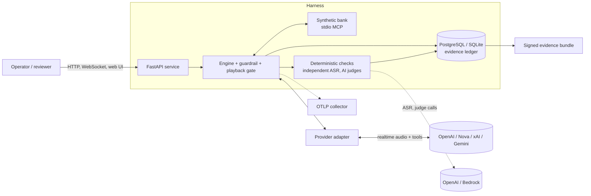
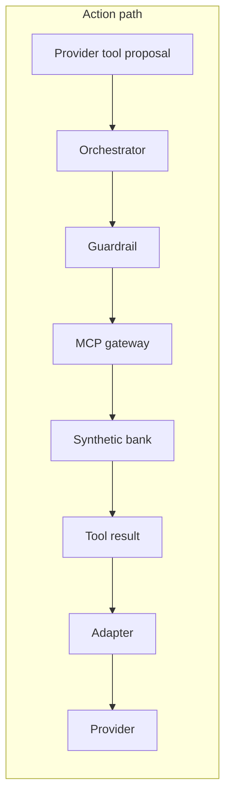
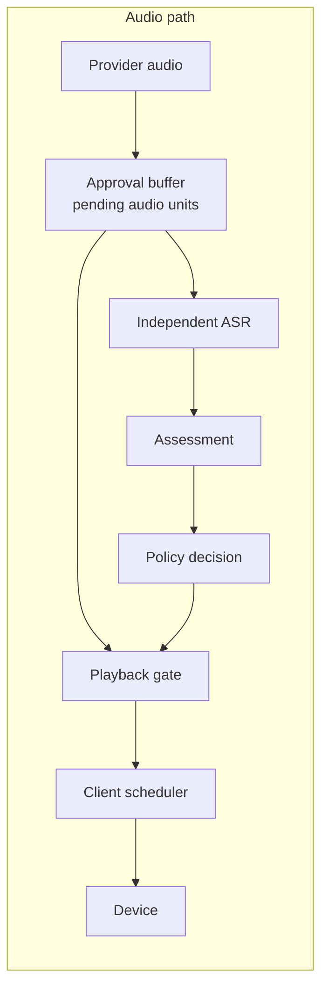
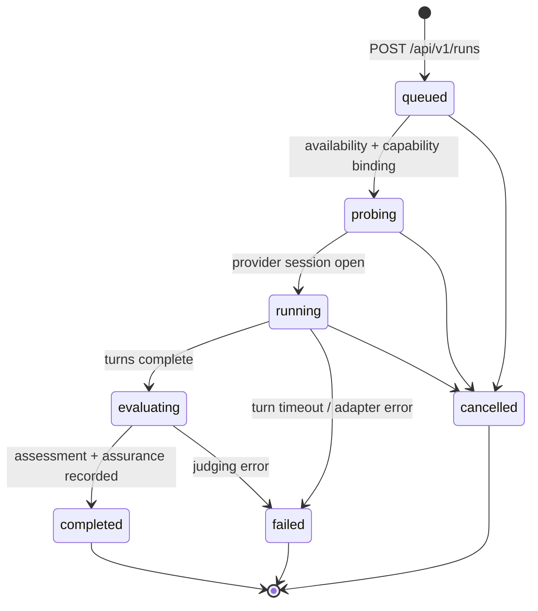
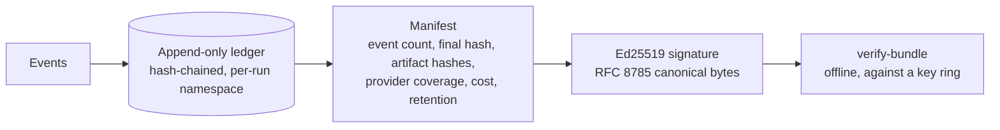
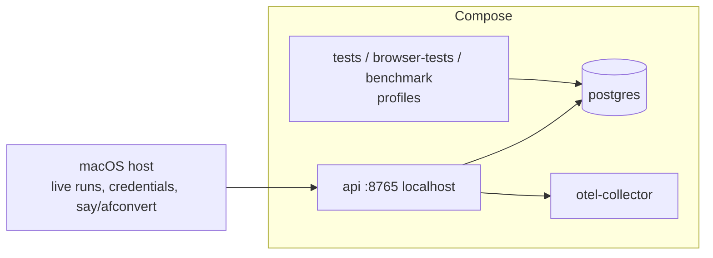

# Architecture

The normative design is `voice_evals_spec_v0.3.md` (§4 architecture, §5 events, §6 playback, §7 judging, §10 evidence).
This document describes what is built. Where the spec and the build differ, the status documents are authoritative.

## 1. Context

Providers and judge services are the only external dependencies. A mock provider runs the same path with no
credentials, which is what CI uses.

## 2. The two authoritative paths

Everything the model under test can do passes through one of two paths. Neither can be bypassed.

- **Action path.** Protected tool proposals are denied before execution unless identity and confirmation state
  allow them. Approval tokens and confirmations are single-use and consumed transactionally. The bank is
  synthetic, with per-run isolated state.
- **Audio path.** Model audio is held as immutable PCM approval units, bound to session, hash, range and epoch.
  Independent ASR transcribes each unit, the assessment decides, and only then does the gate release it. Every
  release has a decision record. Audio *input* has no direct route to output.
- Judges read evidence. Only the guardrail turns a configured judge signal into an enforcement decision, and AI
  signals remain advisory until a calibration policy is approved.

## 3. Components and modules

Package: `src/voice_harness/`.

| Layer | Modules | Responsibility |
|---|---|---|
| Entry and service | `__main__.py`, `api.py`, `auth.py`, `ratelimit.py`, `shutdown.py` | CLI (`serve`, `demo`, `golden-run`, `recovery-run`, `benchmark`, `verify-bundle`, `signing-keys`), authenticated HTTP/WebSocket, operator and reviewer roles, rate limits |
| Orchestration | `engine.py`, `execution.py`, `tool_lifecycle.py`, `inbound_queue.py` | Run lifecycle, ordering, cancellation, bounded queues, tool lifecycle and recovery |
| Enforcement | `guardrail.py`, `policy.py`, `approvals.py`, `playback.py`, `verdicts.py`, `voice_confirmation.py` | Pre-execution and pre-playback decisions, signed single-use approval tokens, playback gate, spoken-consent classifier |
| Synthetic world | `bank.py`, `mcp_server.py`, `mcp_gateway.py`, `data/` | Accounts, transactions, limits, identity state, fault injection; stdio MCP server and correlated gateway |
| Providers | `adapters/` (`openai_realtime`, `nova_sonic`, `xai_voice`), `mock_provider.py`, `resample.py` | `LiveAdapter` protocol over canonical events; original provider payloads preserved |
| Scenarios | `scenario_defs.py`, `scenario_catalogue.py`, `scenarios.py`, `live_scenario.py`, `caller_voice.py`, `model_simulator.py`, `simulator.py` | 3 mock built-ins and 24 live catalogue entries (persona × locale × audio profile, plus faults); synthetic caller speech; model-driven simulator branch |
| Live runs | `live_providers.py`, `live_assessment.py`, `asr.py` | Availability checks, `run_live`, capability binding, independent-ASR assessment |
| Judging | `judges/` (`rubric`, `facts`, `oracle`, `calibration`, `holdout`, `review`, `adjudicate`, `backends`, `independence`, …) | Rubric `banking.assurance.v1`, deterministic evaluators, AI judges, calibration, human review |
| Evidence | `events.py`, `event_contracts.py`, `evidence.py`, `exports.py`, `canonical.py`, `signing.py`, `storage.py`, `relational.py`, `retention.py` | Hash-chained ledger, RFC 8785 canonical JSON, Ed25519-signed manifests, retention and tombstones |
| Capability and coverage | `capability_report.py`, `probe.py`, `coverage.py`, `*_report.py`, `fault_dispositions.py` | Probes produce capability reports; coverage derives per-family state and never ranks |
| Cost and measurement | `cost*.py`, `pricing.py`, `metrics.py`, `benchmark.py`, `websocket_benchmark.py`, `clock_*.py`, `telemetry.py`, `comparison*.py` | Cost lines (unknown unless priced), component benchmarks, OTLP export, comparison reports |
| Contracts | `contracts.py`, `generate_contracts.py` | Closed pydantic models (unknown properties rejected); regenerates `contracts/` schemas and OpenAPI |
| Web | `apps/web/` | Coverage (AC-20), runs, review pages; PCM scheduler and AudioWorklet playback; strict CSP, `textContent` rendering |

## 4. Live run lifecycle

Within `running`, `LiveScenarioRunner` synthesises caller speech, sends 20 ms chunks to the adapter, and
`AdapterTurnDriver` handles the provider's events: tool calls go through the guardrail and MCP gateway, audio goes
to the approval buffer, and independent ASR plus the assessor decide release. A cancelled run emits no
`run.completed`, no assessment and no assurance. The ledger is the source of truth throughout.

## 5. Judging and verdict model

- **Two tracks.** Model behaviour (what the provider did) is separate from platform enforcement (whether the gate
  contained it). A blocked model misstatement is still a model failure.
- **Deterministic criteria:** IDENTITY-01, FACT-01, CONFIRM-01, AUDIO-01, SCENARIO-PROPOSAL-01. CARE-01 needs a
  judge. Applicability is declared per scenario. Missing audio is not "not applicable".
- **FACT-01** compares the *independent ASR* text, not the provider's own transcript, against the tool results and
  reference facts: amounts, and dates and identifiers bound to their entity and field. Unresolved evidence is
  `untestable`, never a pass.
- **Dispositions:** `pass`, `fail`, `untestable`, `not_applicable`. Supported failures are not masked by evidence
  gaps. Unexercised faults are distinguished from handled faults and cannot alone yield an overall pass.
- **AI judges** (OpenAI `gpt-4.1-mini`, Bedrock Claude Haiku 4.5) are opt-in, independence-checked against the
  tested model, calibrated on a synthetic holdout, and advisory. Calibration to date clears the numeric
  thresholds for CARE-01 only; no policy is approved.

## 6. Evidence

- Evidence-write failure blocks tool calls and releases. Trace-export failure never loses ledger data.
- The key ring is the trust root and is obtained out of band. Revoked keys fail every signature they made.
  Retention purges are explicit tombstones, and missing or purged audio is stated.
- Role-restricted reviewer views are separately signed derived manifests, linked to their source by hash.

## 7. Provider adapters

All adapters implement `LiveAdapter` and emit closed canonical events (audio out, transcript delta and final, tool
call, turn start and end, interrupted, usage, error). Unsupported features are declared, not faked
(`CapabilityUnsupported`).

| Family | Model | Transport | Coverage |
|---|---|---|---|
| OpenAI Realtime | `gpt-realtime-2.1` | WebSocket | Verified (AC-09 pass) |
| Amazon Nova Sonic | `amazon.nova-2-5-sonic`, us-east-1 | Bedrock bidirectional stream via a Node bridge | Verified (AC-09 pass, interruption excluded) |
| xAI Grok Voice | `grok-voice-3.0` | WebSocket | Verified (AC-09 5 of 5) |
| Google Gemini Live | `gemini-3.8-live` | Vertex AI Live WebSocket, ADC | 3.8 live probe and AC-09 pass (client truncation excluded); version unresolved |

Support state is *derived*, never asserted. `implemented_and_verified` needs an adapter, a valid unexpired
capability report and a passing AC-09 result bound to that report. Provider quirks that shaped the adapters are
recorded in `PHASE4_NOTES_*.md`.

## 8. Deployment

PostgreSQL and OTLP ports are internal to Compose. The API binds to loopback on 8765. Live provider runs currently
need a macOS host because the default synthetic caller uses `say`/`afconvert`, or the opt-in `openai_tts` voice.

## 9. Known limits

- Fixture audio is silence, so mock-provider tests show enforcement mechanics, not audibility or ASR accuracy.
- Live results are mostly single samples. Cost is `unknown` for real runs because no tariff is established.
- Audio alignment, reconnect/resume and direct MCP are Unknown for every provider.
- Narrowband and noise are simple synthetic shaping, not measured telephony.
- Private signing keys live on disk; there is no KMS or HSM.
